# 浮屿工坊 · 奇想群岛

**被认真对待的小心愿，会长成真实的地方和生命。**

第三章「万物奇想记」：一个可以旅行、结识伙伴、参与冒险，也可以采集、制作和塑形的原创奇幻沙盒。中央故乡的五片风土，沿道路连接泡泡海港、齿轮集市、糖沙旷野与极光雪境。

保留奶油纸本 UI、低多边形手办造型、三阶卡通光与黑色描边。游戏通过本地 Three.js 静态运行；奇想剧场的数据、场景和样式放在独立模块中。

[世界与角色设定集](docs/WORLD_BIBLE.md) · [原始需求与早期设计](GAME_DESIGN.md) · [游戏入口](index.html)

## 街巷与高架 · 城市扩展

默认 `LUMEN-07` 地图新增 **10 片街区、144 幢小屋与店铺**，地面道路从 27 段增加到 **105 段**。环街、支路、沿街商铺、阳台、屋顶花园和灯饰让城镇连成更丰富的生活空间；森林、海港、糖沙和雪境各有建筑配色与屋顶形态。

**4 条高架都能实际通行**：铃海空中大道、花钟环城高架、星邮观景长桥、薄荷回风栈道。步行或驾驶邮车、小巴沿坡道上桥，桥下仍可穿行；桥上位置可随进度保存。40 位街头小居民与 8 辆观光班车沿固定路线活动，窗灯和桥灯随昼夜变化。

按 **M** 打开地图，向下翻到「沿着街巷，走到屋顶上方」，可直达十片街区或四条高架的坡道入口。地图使用实际道路与建筑坐标绘制。

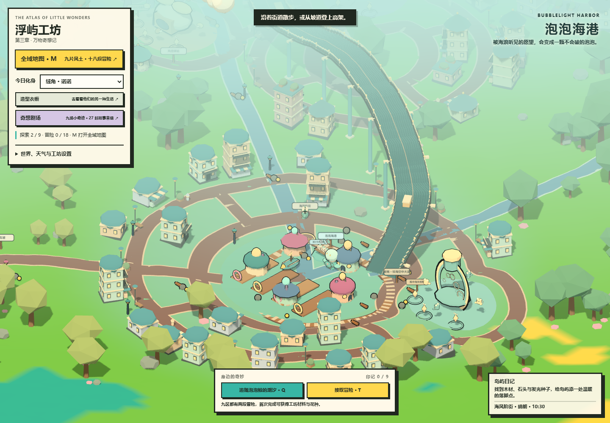

[城市布局、交通与实现范围](docs/CITY_AND_SKYWAYS.md)

## 万物奇想记 · 已可游玩

左上角打开 **奇想剧场**，或在全域地图点击 **✧**。九处新地点把角色的兴趣变成真实可参与的事件：云朵吐司邮局、倒雨茶会、回声水母剧院、借月灯塔、口袋鲸空港、瓶中海失物馆、慢半拍旋转天台、会散步的薄荷绿洲、未完结的极光书屋。

- **H** 开始／参与剧场，**E** 和做客的居民交谈。时机、音序、空间寻找三类互动，每处完成三次回应。
- 日光、月色、天候各有不同故事结尾，共 **27 张明信片**；新卡赠一粒花种，重玩不重复奖励。
- 新增「口袋远游社」「万物借我一天」两系列，合计 **60 种三维造型，其中 30 种可穿**。
- 居民穿着新造型到剧场做客，面团鸟、杯盏蛙、玻璃水母和布丁蜗牛等小生命围绕地标活动。
- JSON **v6** 保存明信片、到访地点和造型，兼容 v2–v5；仍需手动保存。进行中的剧场小互动不恢复。

[研究依据、世界设定与完整玩法](docs/WORLD_TALES.md)

## 去更远的地方

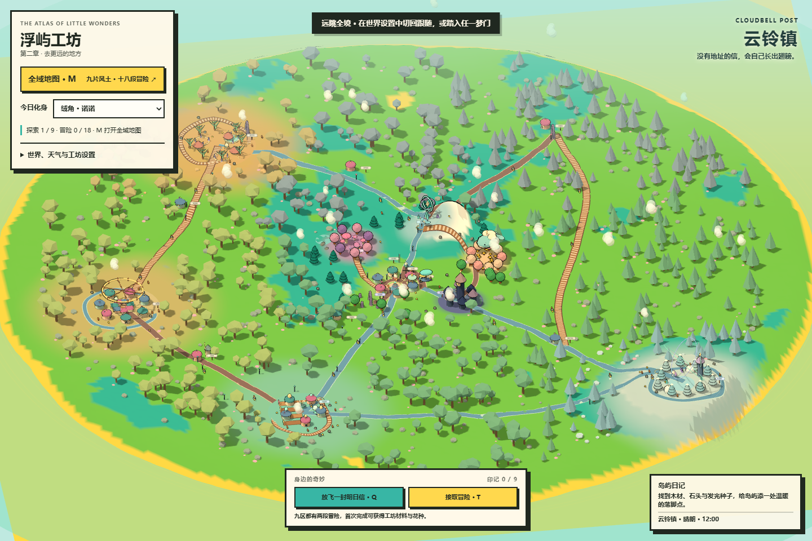

- 可步行边界由半径 40 扩至 134，跨度约为原先的 3.3 倍；九区位于同一张连续地图，可以步行、奔跑或驾驶抵达。
- 七条远行干道连接外圈与中央故乡，配合区域环路、门前小径共 27 段道路。
- 风信驿站、风车坡、银砂营地、回声旧站、雪线中转站与旧观星台，让途中也有落脚点和探索目标。
- 地图按种子生成起伏、数百株批量植被、岩石与花簇；资源分布到原有区域、远方聚落与道路沿线。
- 全域地图显示九区、当前位置和下一个冒险目标，支持梦门直达与全境远眺。

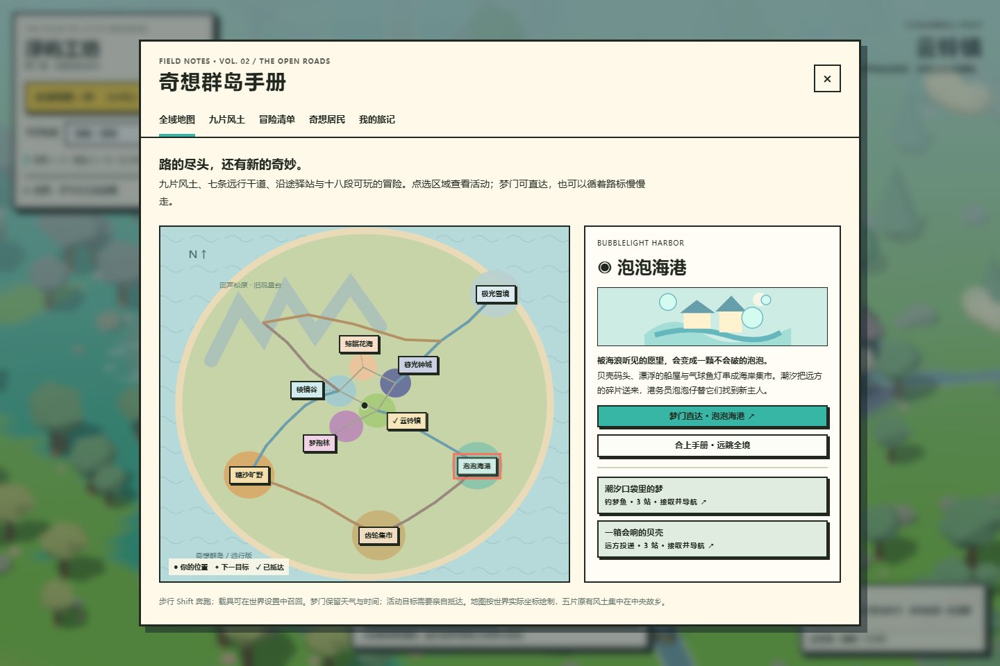

## 九片风土

| 区域 | 景观与奇妙规则 | 区域奇遇 |
| --- | --- | --- |
| 云铃镇 | 蜜糖屋顶、薄荷邮塔；没有地址的信会长出翅膀 | 明日信巡游 |
| 梦孢林 | 浆果菌林、悬灯花；雨滴向上落，梦在伞下发芽 | 倒雨花开 |
| 棱镜谷 | 冰蓝晶脊、悬浮星环；记忆凝结成水晶 | 棱镜共鸣 |
| 暮光钟城 | 靛色尖塔、黄铜时钟；有人守夜，星星就不会熄灭 | 长明巡夜 |
| 鲸眠花海 | 杏色草坡、珊瑚花树；云鲸呼吸时花开成潮 | 云鲸花汐 |
| 泡泡海港 | 贝壳码头、泡泡灯、船屋与浮舟；海浪把愿望装进泡泡 | 泡泡鲸归港 |
| 齿轮集市 | 轮盘、摊位、风车坡；发条会偷偷长出自己的节奏 | 齿轮午后 |
| 糖沙旷野 | 沙丘、棕榈绿洲、晶簇、帐篷与古拱门；沙丘记住旅人的脚印 | 糖晶沙暴 |
| 极光雪境 | 雪松、冰湖、雪屋、星灯邮局；雪会记住曾照亮它的光 | 雪境星邮 |

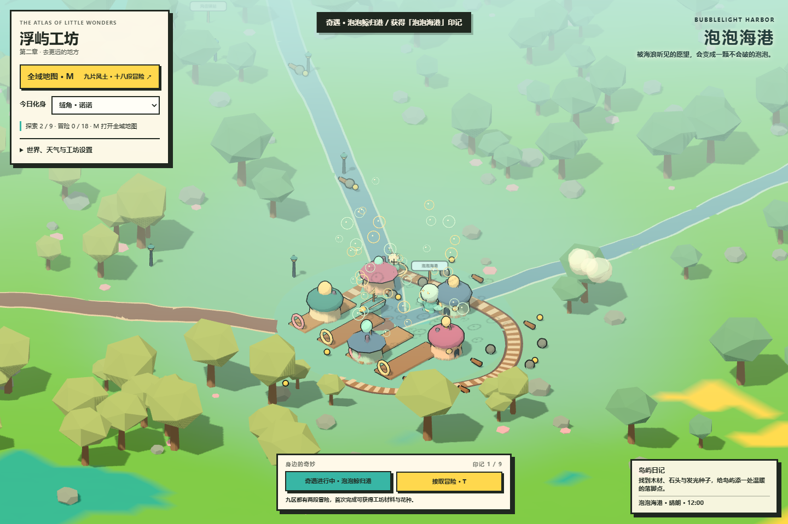

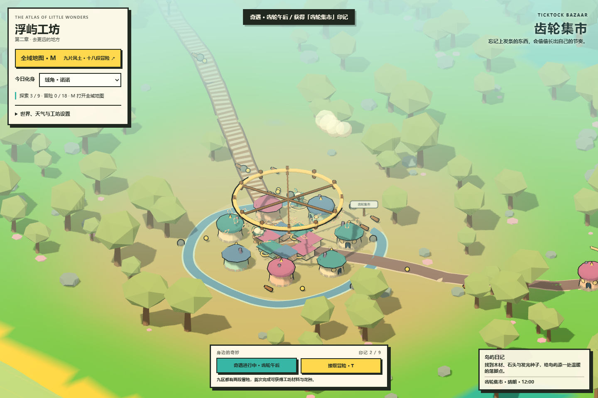

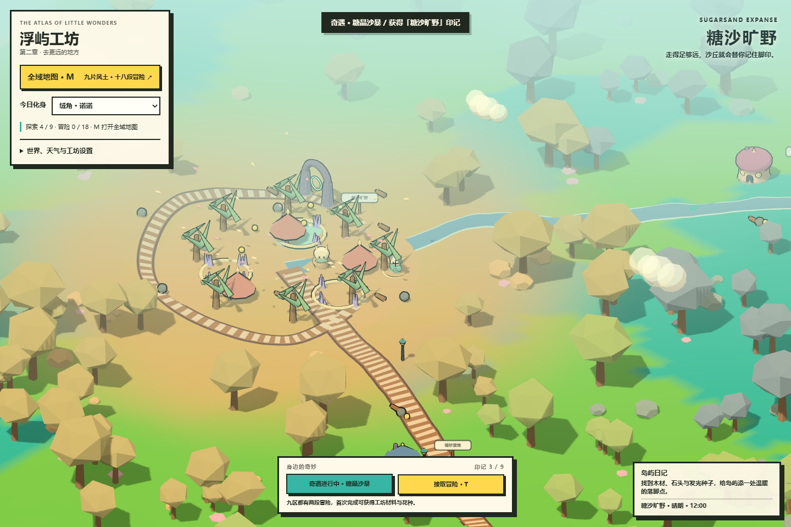

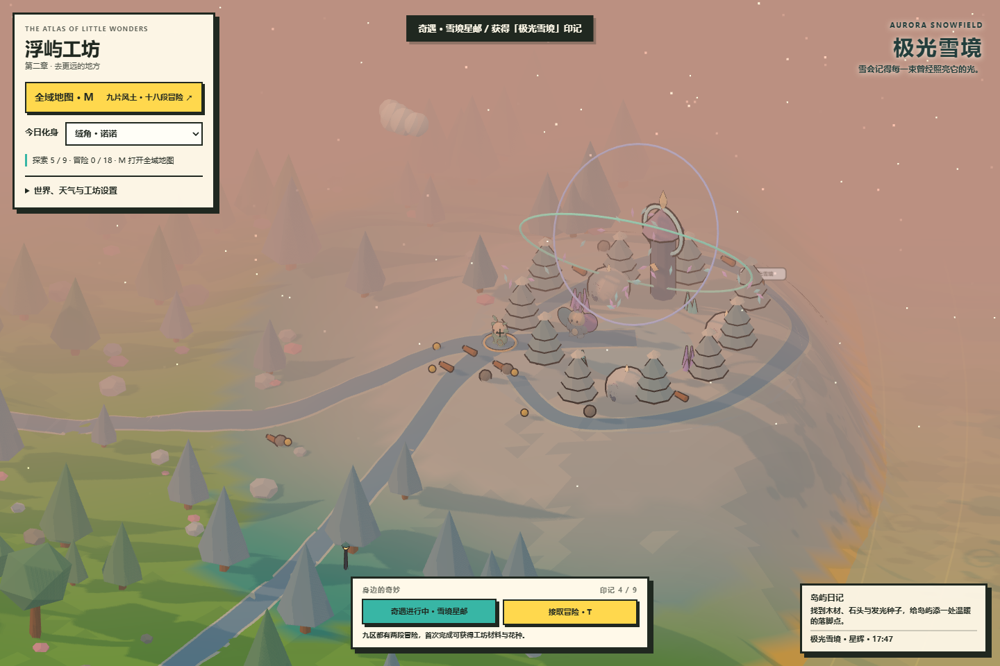

靠近居民按 `E` 交谈；在区域内按 `Q` 触发可重复的奇遇，记录区域印记。任意五枚印记点亮随身造梦者星环，集齐九枚后扩为九星远行星环。梦门保留天气与昼夜设置。

以上图片均来自浏览器实际运行画面。

## 一位朋友，许多种可能

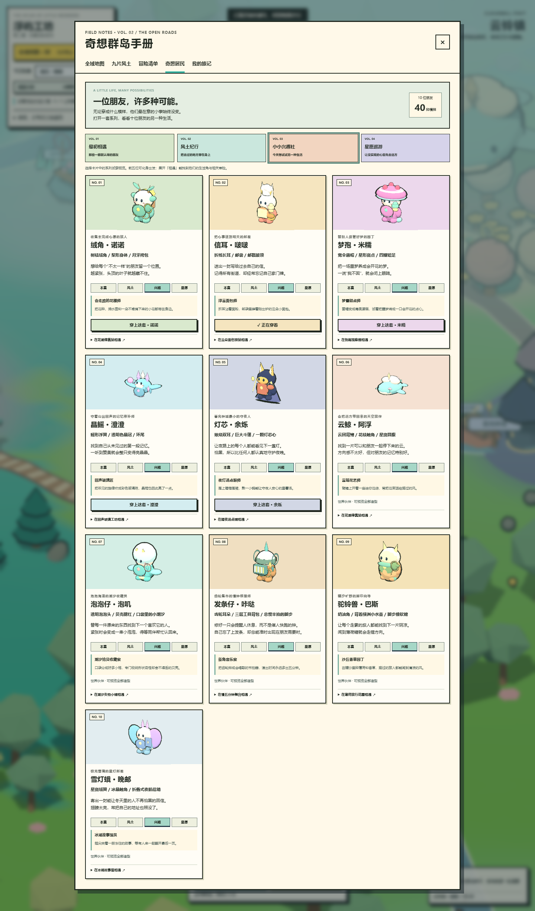

十位原创角色都有独立、稳定的心愿与识别轮廓；每一位还配有本真、风土、兴趣、星愿、远游、奇妙六种可预览的三维造型，共 60 种组合。米糯在倒雨池戴上青蛙观察帽，啵啵尝试做浮云面包，余烁煮起暖夜星薯汤，咔哒用旧闹钟修成手风琴。人物的性格与关系保持连贯，旅途和爱好给他们带来新的故事。

在左上角打开「造型衣橱」，可以按系列一次预览十位伙伴，也可在单独卡片中细看。前五位可穿上任一造型成为今日化身，每位化身记得自己上次穿过的衣服；保存进度后可随旅途一起读回。预览和穿着是独立操作，试着看看不会立即改变正在使用的形象。

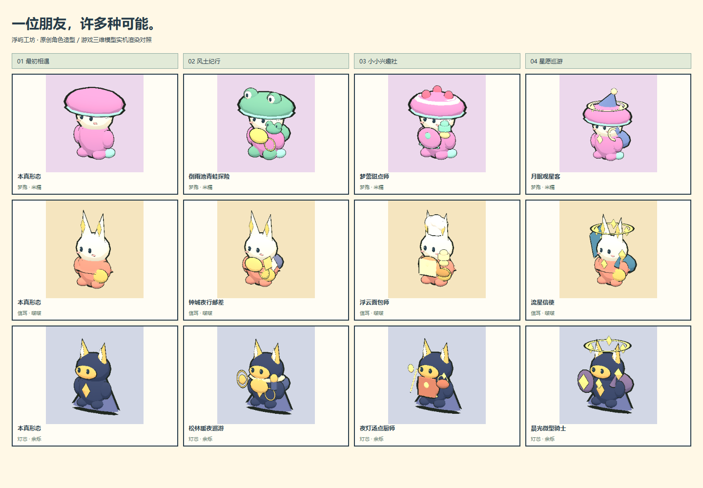

九处生活角把角色兴趣变成了地图中的小地方：云朵面包驿站、倒雨观察棚、回声玻璃工坊、暖夜汤点铺、花潮停靠站、潮汐失物小铺、慢五分钟舞台、薄荷旅行花圃与冰湖故事屋。场景居民穿着相应造型，并新增一句生活对话。手册的「相遇」和「九片风土」页可直达生活角、接取相关的现有冒险。

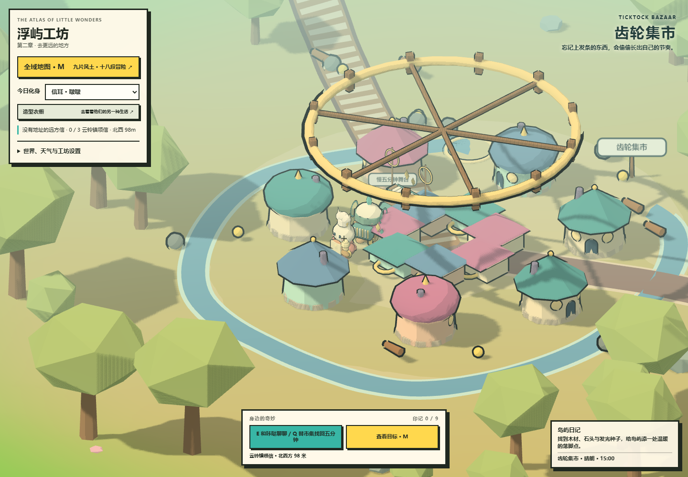

## 十八段可玩的冒险

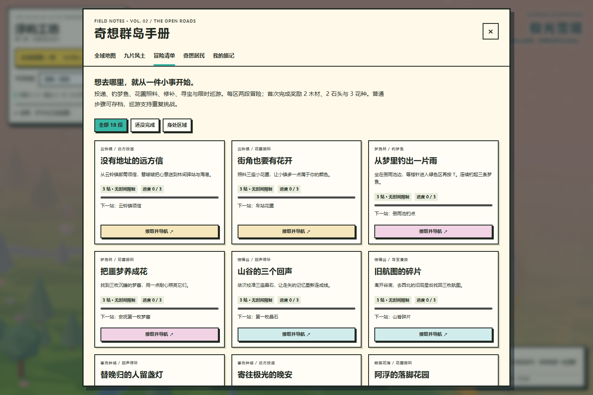

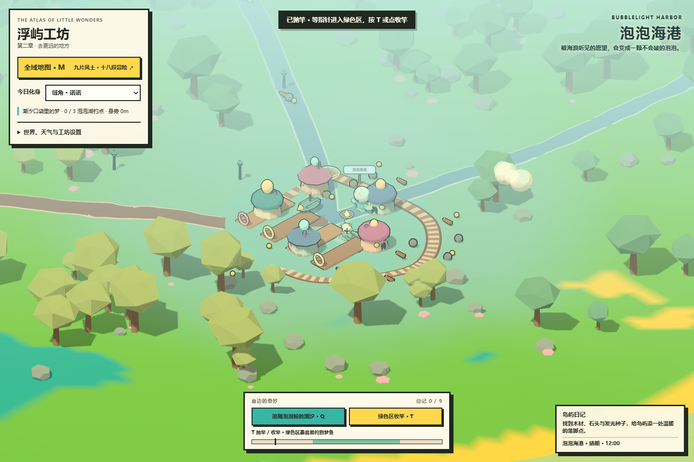

在地图或“冒险清单”接取任务，跟随金色菱星走到目标地点。面板显示下一站、方向与距离；`T` 或底部活动按钮执行动作。普通任务只显示下一站，巡游显示剩余检查环；已照料的花圃与已修补的装置保留在世界中。

| 玩法 | 参与方式 | 例子 |
| --- | --- | --- |
| 远方投递 | 按顺序领取、盖章、交付，跨区送达 | 云铃镇 → 风信驿站 → 海港；钟城 → 雪线 → 星灯邮局 |
| 钓梦鱼 | `T` 抛竿，等指针进入绿色区再收竿，钓满三条 | 倒雨池、泡泡湖 |
| 花圃照料 | 依次照料三枚梦蕾或花圃，完成后花朵长大 | 街角花圃、梦孢园、阿浮的花园 |
| 回声修补 | 寻找三处装置并依次唤醒，装置改变旋转与形态 | 晶石回声、钟城夜灯、集市发条、极光星邮灯 |
| 寻宝漫游 | 寻找三枚碎片，收取后场景中的碎片消失 | 旧航图、糖晶、星灯邮票 |
| 道路巡游 | 起点按 `T` 开始，在限时内依次穿过实体检查环 | 追随云鲸、环城拉力、软糖沙丘巡游 |

每区两段冒险，共 18 段。首次完成每段获得 **2 木材、2 石头、3 花种**；可以重玩，材料奖励仅领取一次。每完成两段，中央远行驿站多亮起一枚星灯。

普通冒险可中途切换并保存步骤。巡游在手册打开时暂停计时，重新接取、切换或读档会回到起点；支持步行与所有载具。钓鱼没有失败惩罚，未钓中可以重新抛竿。

## 十位伙伴与四种出行方式

| 伙伴 | 形象与心事 | 相遇地点 |
| --- | --- | --- |
| 绒角·诺诺 | 树枝绒角、月牙挎包；想为不同的朋友留一个位置 | 鲸眠花海 |
| 信耳·啵啵 | 折纸长耳、邮袋；记得街道，却忘了自家门牌 | 云铃镇 |
| 梦孢·米糯 | 宽伞菌帽、四瓣短足；想把噩梦养成花 | 梦孢林 |
| 晶鳐·澄澄 | 鳐形浮翼、晶冠环尾；修补记忆，也寻找自己的来历 | 棱镜谷 |
| 灯芯·余烁 | 烛焰双耳、大斗篷；怕黑却坚持守夜 | 暮光钟城 |
| 云鲸·阿浮 | 云团背鳍、星斑圆腹；总迷路，却记得朋友 | 鲸眠花海上空 |
| 泡泡仔·泡叽 | 泡泡头、贝壳饰物；替漂来的东西寻找新主人 | 泡泡海港 |
| 发条仔·咔哒 | 齿轮耳朵、发条；想修出一只提醒人休息的钟 | 齿轮集市 |
| 驼铃兽·巴斯 | 奶油角、软糖脚步；想替旅人找到下一片阴凉 | 糖沙旷野 |
| 雪灯蛾·晚邮 | 绒翼、冰晶触角；把星光寄给冬夜里的人 | 极光雪境 |

前五位可成为玩家化身，手册肖像由实际三维模型渲染。化身改变外观；世界中的同名居民仍可相遇。

林叶邮车、云铃小巴、星帆艇与海港的**贝壳浮舟**均可召回和驾驶。浮舟是贴地悬浮的奇幻载具，可在陆地巡游；星帆艇还可升降。车辆速度适配了更大的地图。

## 沙盒、天气与昼夜

- 采集木材、石头和发光种子，制作篝火、长凳，种花并抬升、降低、平滑地形。新区域也可创作。
- 篝火消耗 3 木材 + 2 石头，长凳消耗 4 木材 + 1 石头，种花消耗 1 花种。
- 自由选择白昼、黄昏、黑夜或自动流转，切换晴朗、多云、细雨、落雪、星辉。
- 天气改变天空、雾、水体、照明与粒子；粒子跟随旅人和所在海拔，夜晚有月亮、星光与灯火。
- 可调视野、跟随/环绕相机与描边；远处描边随雾衰减。

## 运行与操作

无需 npm、构建工具或后端。在仓库目录启动静态服务器：

```powershell
python -m http.server 8080
```

打开 <http://127.0.0.1:8080/>。本地部署版已内置 Three.js `0.161.0`，游戏运行无需访问 CDN。

Windows 也可运行 `powershell -ExecutionPolicy Bypass -File .\start-local.ps1 -OpenBrowser`，在后台启动仅本机可访问的服务；停止服务运行 `powershell -ExecutionPolicy Bypass -File .\stop-local.ps1`。两者默认使用 8080 端口，可用 `-Port` 指定其他端口。部署说明与源码研究见 [PROJECT_RESEARCH.md](PROJECT_RESEARCH.md)。

| 操作 | 键位 / 入口 |
| --- | --- |
| 移动 / 驾驶 | `WASD` / 方向键 |
| 奔跑 / 跳跃 | 步行 `Shift` / `Space` |
| 交谈 / 采集 | `E` |
| 区域奇遇 / 活动互动 | `Q` / `T` |
| 奇想剧场互动 | `H` / 底部按钮 |
| 全域地图 | `M` / 左上按钮 |
| 上下车 | `V`，或世界设置面板召回、乘坐 |
| 星帆艇升降 | `Space` / `Shift` |
| 种花 / 篝火 / 长凳 | `P` / `C` / `B` |
| 抬升 / 降低 / 平滑地形 | `R` / `F` / `G` |
| 关闭手册 / 对话 | `Escape` |

触屏提供方向、跳跃、交互、种植、乘车、奇遇和活动按钮；手册支持触摸。星帆艇升降仍使用键盘。

## 存档与截图

“保存进度”与旅记中的保存按钮写入浏览器 `localStorage`；支持 JSON 导出、导入和场景 PNG 截图。

JSON **v6** 额外保存剧场明信片、到访地点，以及每位化身选择的系列造型，还保存天气、时间、四款载具、角色、资源、设施、花朵、地形、已访区域、伙伴、九区印记、冒险步骤、已完成记录、梦鱼与旅行里程。支持 v2–v5 迁移：缺少的外观补为本真形态，缺少的冒险记录补为空进度。载入时保留原坐标并恢复到所在的地面或桥面；不保留正在进行的抛竿和巡游计时。

城市扩展沿用 v6，读取角色高度，并补充车辆高度，以恢复桥上／桥下的位置。旧档没有车辆高度时，车辆回到地面。新建筑会避开原有任务与剧场，但旧档若位于新增建筑内部，载入时会移到建筑外侧。

重新生成会重置当前世界与旅程，保留上一次手动存档。没有自动保存或云端同步。“截图”下载场景画布；本文展示图包含页面 UI。

## 当前范围

当前是一张有限、连续的九区大地图，包含十片城市街区、四条可通行高架、九处奇想剧场、27 种故事结尾、九处生活角、60 种三维角色造型、固定居民对话、区域演出与十八段有明确步骤的活动。前五位角色的 30 种造型可穿，其余是衣橱中的三维预览。造型目前自由开放，没有解锁经济或数值加成；原有生活角连接场景、对话与既有活动；新增奇想剧场提供时机、音序和空间寻找三类轻量互动，尚无完整烹饪或音游系统。角色长期成长、多章节主线、关系数值、战斗、声音、季节、联机和无限地图仍未实现。

建筑具有简单碰撞，环境没有完整物理模拟。聚落与道路是生成环境；玩家可种花、制作两类设施及改造地形。批量植被用于填充远方，可随着地形编辑重新贴地。

## 文件与技术

```text
index.html                 Three.js 游戏主入口
world-tales.js             奇想剧场、故事与造型数据
world-tales.css            故事集与互动界面
world-city.js              城市街区、批量建筑、立体道路与通行表面
world-city.css             地图中的街区与高架导览
GAME_DESIGN.md             原始附图需求与早期设计档案
docs/WORLD_BIBLE.md        原创世界、角色与当前实现范围
docs/CITY_AND_SKYWAYS.md    城市扩展、通行与验证说明
docs/screenshots/          浏览器实机展示图
```

连续噪声地形、面级配色、`MeshToonMaterial` 三阶 Gradient Map、Inverted Hull 描边、正交相机、阴影、批量植被和 Canvas 三维肖像。不依赖外部模型、纹理或生成式剧情服务。

本项目使用 [MIT License](LICENSE)。Three.js 的本地副本及 MIT 许可证位于 `vendor/three-0.161.0/`，来源和校验值见该目录的 `SOURCE.md`。
