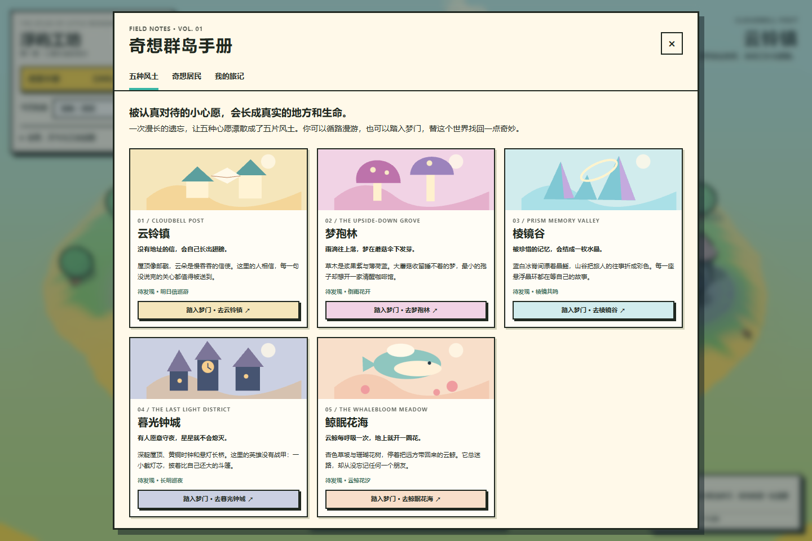
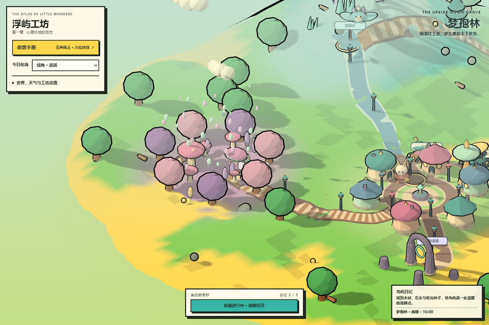
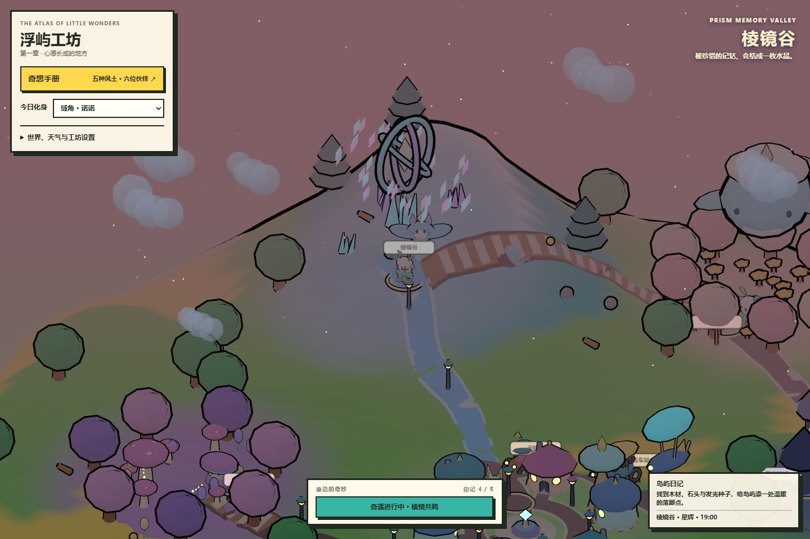
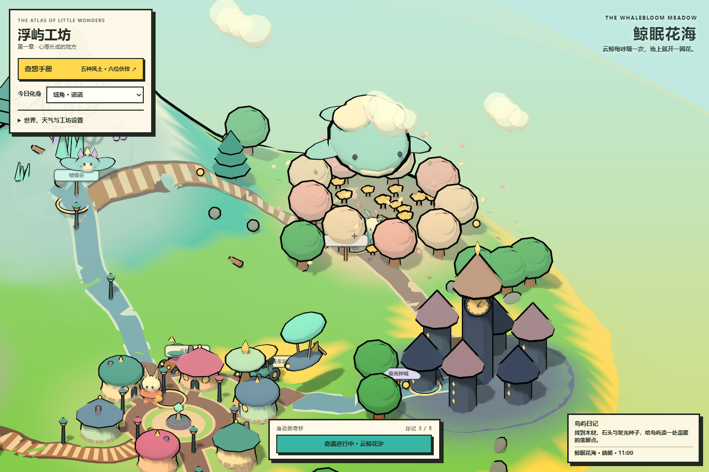

# 浮屿工坊 · 奇想群岛

**被认真对待的小心愿，会长成真实的地方和生命。**

一个可以探索、结识伙伴、触发奇遇，也可以采集、制作与塑形的原创奇幻浮岛沙盒。五片风土拥有不同的色彩、建筑、生态与奇妙规则：没有地址的信会长出翅膀，梦里的雨向上落，云鲸呼吸时花海涌起。

项目保留奶油纸本 UI、低多边形手办造型、卡通阶梯光与黑色描边。单个 HTML 即可运行，当前把五片风土浓缩在一座种子生成的浮岛上。

[世界与角色设定集](docs/WORLD_BIBLE.md) · [原始需求与完整设计](GAME_DESIGN.md) · [入口文件](index.html)

## 看看这个世界

五片风土的全岛远景：


翻开奇想手册，通过梦门前往各区：



六位原创伙伴，前五位可以成为你的今日化身：


梦孢林的倒雨、暮光钟城的夜灯与鲸眠花海的花汐：








以上均为当前原型在浏览器中实际运行的截图；手册人物小像直接由游戏中的三维模型渲染。

## 五片风土

| 区域 | 风土与规则 | 可以触发的奇遇 |
| --- | --- | --- |
| 云铃镇 | 蜜糖屋顶、薄荷邮塔；没有地址的信会长出翅膀 | 明日信巡游：纸鸟绕着镇子飞向天空 |
| 梦孢林 | 浆果紫菌帽、悬灯花；雨滴向上落，梦在伞下发芽 | 倒雨花开：孢子与水滴升空，花灯苏醒 |
| 棱镜谷 | 冰蓝晶脊、悬浮星环；记忆凝结成水晶 | 棱镜共鸣：碎晶悬起，围成记忆星环 |
| 暮光钟城 | 靛色尖塔、黄铜时钟；有人守夜，星星就不会熄灭 | 长明巡夜：灯芯升空，拼回守望星座 |
| 鲸眠花海 | 杏色草坡、珊瑚花树；云鲸呼吸时花开成潮 | 云鲸花汐：阿浮跃起，花瓣漫过山坡 |

各区通过连续道路相连，也可在“奇想手册”中踏入梦门。旅行改变位置与视野，保留你选择的天气和时间。

## 认识伙伴

| 伙伴 | 形象与心事 | 当前用途 |
| --- | --- | --- |
| 绒角 · 诺诺 | 树枝绒角、梨形身体、月牙挎包；想给每个不同的朋友留一个位置 | 化身 / 花海居民 |
| 信耳 · 啵啵 | 折纸长耳、邮袋；记得所有街道，却常忘记自己家的门牌 | 化身 / 云铃镇邮差 |
| 梦孢 · 米糯 | 宽伞菌帽、四瓣短足；想把噩梦养成会开花的梦 | 化身 / 梦孢林园丁 |
| 晶鳐 · 澄澄 | 鳐形浮翼、晶冠、环尾；修补别人的记忆，却缺失自己的来历 | 化身 / 棱镜谷伙伴 |
| 灯芯 · 余烁 | 烛焰双耳、巨大斗篷、灯芯心；怕黑却坚持守夜 | 化身 / 暮光钟城守夜人 |
| 云鲸 · 阿浮 | 云团背鳍、星斑圆腹；总迷路，却记得每一个朋友 | 大型天空旅伴 / 花海居民 |

靠近伙伴按 `E` 或点击触屏“交互”可交谈。化身目前改变外形；同名居民仍会留在世界中，方便体验。能力差异和长篇角色故事属于后续设计。

## 已经可以玩什么

- 通过区域、居民、旅记三个手册页了解世界，旅行、切换化身、保存旅程。
- 亲历五种可重复的区域奇遇，获得五枚印记；集齐后点亮随身的“造梦者星环”。
- 旅记记录已访区域、结识伙伴与奇遇印记。
- 用字符串种子生成可复现的有限浮岛，在连续起伏地形上移动、跳跃和探索。
- 采集木材、石头与发光种子，制作篝火、长凳，种花并抬升、降低、平滑附近地形。
- 在五片风土和风铃遗迹之间，沿道路驾驶林叶邮车、云铃小巴或升降式星帆艇。
- 手动选择白昼、黄昏、黑夜，或让时间自动流转；自由切换晴朗、多云、细雨、落雪与星辉天气。
- 天气改变天空、雾、水体、照明与粒子；夜晚出现月亮、星光和更明亮的灯火。
- 调整视野、跟随或环绕镜头、描边；通过桌面键盘或触控按钮操作。
- 手动本地存档、JSON 导出/导入，下载场景 PNG 截图。

## 运行

项目不需要 npm、构建工具或后端。推荐在仓库目录启动静态服务器：

```powershell
python -m http.server 8080
```

打开 <http://127.0.0.1:8080/>。也可以尝试直接打开 `index.html`，但部分浏览器会限制 `file:` 页面的模块加载。

首次运行需访问 Three.js `0.161.0` 的 CDN：

```text
https://cdn.jsdelivr.net/npm/three@0.161.0/build/three.module.js
```

如果只有背景而没有岛屿，请检查 CDN 网络连接或代理。

## 键位与操作

| 操作 | 键位 / 入口 | 说明 |
| --- | --- | --- |
| 移动 / 驾驶 | `W` `A` `S` `D` / 方向键 | 沿起伏地形漫游 |
| 跳跃 | `Space` | 步行时起跳 |
| 交谈 / 采集 | `E` | 近处伙伴优先交谈，否则采集资源 |
| 区域奇遇 | `Q` / 底部按钮 | 触发当前区域的演出与印记；乘车时先下车 |
| 奇想手册 | 左上“奇想手册” | 区域梦门、居民介绍、化身和旅记 |
| 关闭手册 / 对话 | `Escape` | 手册打开时暂停移动输入 |
| 上下车 | `V` / 面板 / 触屏“乘车” | 在载具附近乘坐；可用面板召回 |
| 星帆艇升降 | `Space` / `Shift` | 驾驶时上升 / 下降 |
| 种花 | `P` | 消耗 1 颗发光种子 |
| 篝火 / 长凳 | `C` / `B` | 按配方消耗材料 |
| 抬升 / 降低 / 平滑 | `R` / `F` / `G` | 改造角色附近的连续地形 |

“世界、天气与工坊设置”收纳了种子、时间、天气、载具、视野、存档等选项；展开“营地工坊”可查看材料和制作配方。触屏提供行走、跳跃、交互、种植、乘车与区域奇遇；星帆艇升降目前使用键盘。

| 项目 | 消耗 |
| --- | --- |
| 篝火 | 3 木材 + 2 石头 |
| 长凳 | 4 木材 + 1 石头 |
| 花朵 | 1 发光种子 |

## 存档与截图

- “保存进度”写入当前浏览器的 `localStorage`；“读取进度”恢复最近一次手动存档。
- 旅记中的“保存这段旅途”使用同一份存档。
- JSON v3 包含世界种子、地形编辑、采集、设施、花朵、资源、角色位置、三款载具，以及化身、区域、伙伴和印记进度。
- 导入旧版存档时默认使用诺诺，并从空的奇遇/伙伴进度继续。
- “重新生成”重置当前岛屿与故事进度，保留上一次手动存档；没有自动保存或云端同步。
- “截图”下载 WebGL 场景画布；README 展示图另包含页面 UI。

## 当前边界

这是可以运行和创作的世界原型。五片风土目前位于同一座浮岛，伙伴有固定的两句对话，奇遇是可重复的限时演出。尚未实现完整任务链、多章节剧情、战斗、角色能力、关系数值、季节、跨岛航行、声音、联机或账号系统。

角色与部分建筑有简单碰撞，环境对象没有完整物理系统。玩家可以种花与制作两类设施；城镇、道路、树木、石块和区域景观属于生成环境。世界设定集中的“空白潮”、角色成长线和扩展角色是后续内容设计。

## 文件与技术

```text
.
├── index.html                 # 可直接运行的完整原型
├── GAME_DESIGN.md             # 原始附图需求、早期设计与分期
├── docs/
│   ├── WORLD_BIBLE.md         # 世界规则、五区、角色与当前实现边界
│   └── screenshots/           # 当前浏览器实机展示图
├── LICENSE
└── README.md
```

使用 Three.js、连续噪声地形与面级配色、`MeshToonMaterial` 三阶 Gradient Map、Inverted Hull 描边、正交相机与硬阴影。手册区域插画由内联 SVG 绘制，人物肖像由实际三维模型离屏渲染；项目不依赖外部模型、纹理或生成式剧情服务。

## 许可证

本项目使用 [MIT License](LICENSE)。Three.js 通过公开 CDN 作为运行时依赖加载。
