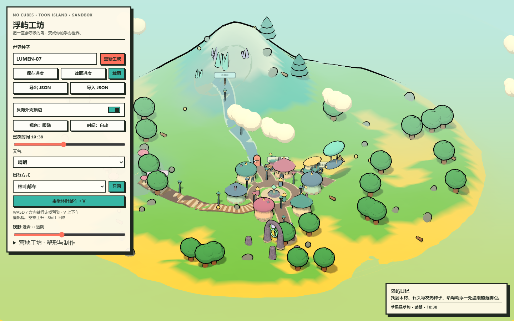
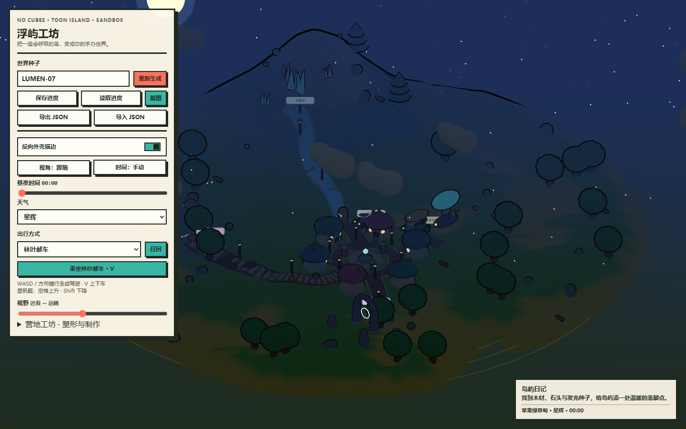

# 浮屿工坊 Floating Isle

一个单文件 HTML 可运行的无方块 NPR 低多边形沙盒原型。

《浮屿工坊》把探索、采集、轻量制作和连续地形塑形放进一座由世界种子生成的奇幻浮岛。玩家可以在海岸、低地和山坡之间漫游，访问云铃镇、水晶谷、蘑菇幽谷与风铃遗迹，沿连续道路驾驶林叶邮车、云铃小巴或升降式星帆艇，再用花朵和地形工具留下自己的改造痕迹。

项目当前定位为 P0 可玩原型：先把一轮“探索 → 采集 → 制作 → 种花 → 塑形 → 保存”的闭环做成可直接体验的单页作品。完整设计与后续规划见 [`GAME_DESIGN.md`](GAME_DESIGN.md)。

## 截图

白昼下的浮岛与云铃镇：



星辉夜色下的浮岛：



截图来自浏览器中实际运行的原型，展示白昼与星辉夜色的场景效果。

## 已实现功能

- 以字符串种子生成可复现的有限浮岛。
- 使用连续噪声生成起伏地形，没有体素、立方体或方块贴图。
- 地形网格使用 `PlaneGeometry`、`toNonIndexed()` 和面级色彩。
- 主要材质使用 `MeshToonMaterial` 与 Canvas 生成的三阶灰度渐变图。
- 地形、角色、树木、石块、花朵和设施使用反向外壳描边。
- 正交等距视角、方向光硬阴影、半球光和环境光共同组成 NPR 光照。
- 海水与波纹常驻，漂浮云、树木、石块和发光资源随世界种子生成。
- 角色可在起伏地形上移动和跳跃；边界会限制角色离开浮岛。
- 靠近资源按 `E` 采集木材、石头或发光种子。
- 以木材和石头制作篝火、长凳，并把设施放在角色附近。
- 消耗发光种子在岛屿内部种下一朵花。
- 对角色附近地形执行抬升、降低或平滑操作。
- 切换跟随视角与自转视角，打开或关闭反向外壳描边。
- 手动锁定太阳时间，或让昼夜自动流转。
- 晴朗、多云、细雨、落雪和星辉五种天气；天气会改变天空、雾、水体、光照与粒子效果。
- 云铃镇、三处奇幻景观、居民、连续道路与三种可驾驶载具；星帆艇支持升降。
- 载具召回、上下车、驾驶、镜头跟随与视野缩放。
- 使用浏览器本地存档、JSON 导出与 JSON 导入保存创作状态。
- 通过页面“截图”按钮导出当前画布 PNG 截图。
- 桌面键盘和粗指针设备上的触控按钮都可操作移动、跳跃、采集和种植。

## 运行

项目不需要 npm、构建工具或后端服务，入口文件是仓库根目录的 [`index.html`](index.html)。

最直接的方式是双击 `index.html`，然后等待 Three.js 模块加载完成。不同浏览器对 `file:` 页面和模块加载的处理可能不同，因此更推荐启动一个静态文件服务器：

```powershell
python -m http.server 8080
```

然后打开 <http://127.0.0.1:8080/>。

运行时通过 CDN 加载 Three.js `0.161.0`：

```text
https://cdn.jsdelivr.net/npm/three@0.161.0/build/three.module.js
```

因此首次运行必须能访问外网 CDN；如果页面只有背景或浏览器控制台出现模块加载错误，请先检查网络、代理或 CDN 可达性。

## 键位与操作

| 操作 | 键位 | 说明 |
| --- | --- | --- |
| 移动 | `W` `A` `S` `D` / 方向键 | 在浮岛上行走 |
| 跳跃 | `Space` | 起跳并回到地形表面 |
| 采集 | `E` | 靠近发光资源后采集最近对象 |
| 种花 | `P` | 消耗 1 颗发光种子，在角色附近种花 |
| 制作篝火 | `C` | 消耗材料并在角色附近放置篝火 |
| 制作长凳 | `B` | 消耗材料并在角色附近放置长凳 |
| 上下车 | `V` | 靠近载具后上下车；面板也有按钮 |
| 抬升地形 | `R` | 在角色附近抬高一小片连续地形 |
| 降低地形 | `F` | 在角色附近降低一小片连续地形 |
| 平滑地形 | `G` | 在角色附近平滑高度变化 |

控制面板还提供世界种子重生成、反向外壳开关、视角切换、自动/手动时间、天气选择、载具召回、视野缩放、保存/读取、JSON 导入/导出和截图按钮。驾驶星帆艇时，`Space` 上升，`Shift` 下降。

## 配方与资源

原型目前有两种设施配方，以及一种种花消耗：

| 项目 | 消耗 | 结果 |
| --- | --- | --- |
| 篝火 | 3 木材 + 2 石头 | 在角色附近放置一处会闪动的篝火 |
| 长凳 | 4 木材 + 1 石头 | 在角色附近放置一张简化长凳 |
| 花朵 | 1 发光种子 | 在岛屿内部种下一朵花 |

木材、石头和发光种子会随世界种子生成。资源需要靠近后按 `E` 采集；材料不足时，页面会提示所需材料。树木和石块是世界生成的环境对象，当前版本没有把树木作为玩家可种植配方。

## 存档与截图

- “保存进度”把当前状态写入浏览器的 `localStorage`。
- “读取进度”读取当前浏览器中该页面的本地记录。
- “导出 JSON”下载一个 `floating-isle-save.json` 文件，可用于备份或迁移。
- “导入 JSON”读取合法的存档文件，并重建种子、地形编辑、采集状态、设施、花朵、资源与角色位置。
- 当前没有云端同步，也没有自动保存；离开页面前请手动保存或导出 JSON。
- “截图”下载 WebGL 画布的 `floating-isle.png`，用于记录岛屿场景。

## 目录

```text
.
├── index.html                 # 可直接运行的单文件原型
├── GAME_DESIGN.md             # 完整设计、需求边界与验收矩阵
├── docs/
│   └── screenshots/
│       ├── daylight.png       # 白昼浏览器截图
│       └── sunset.png         # 日落浏览器截图
├── LICENSE                    # MIT License
└── README.md
```

`index.html` 内部按功能组织为种子随机、噪声地形、生态对象、角色移动、资源采集、设施布置、地形编辑、时间光照、存档和 UI 事件等部分；没有独立运行时服务或构建产物。

## 视觉与技术约束

- 连续起伏地形取代方块堆叠，保持自然的浮岛轮廓。
- `MeshToonMaterial`、三阶 Gradient Map 与高饱和色彩共同构成卡通阶梯光。
- Inverted Hull 反向外壳提供统一的黑色手办描边。
- `OrthographicCamera`、`PCFShadowMap`、方向光和环境光保持等距沙盘观感。
- Three.js 只作为 CDN 运行时依赖；原型不含纹理包、模型包或音频资源。

## 原型限制

这是一个可玩的 P0 竖切片，不是完整商业游戏。当前版本明确保留以下边界：

- 没有声音、音乐、联机、云存档、任务剧情或账号系统。
- 没有无限世界、复杂 AI、真实物理建造或方块编辑。
- 角色主要按高度场贴合地面，设施和植被之间没有完整的物理碰撞系统。
- 地形编辑服务于附近的小范围塑形，不能替代通用建造工具。
- 玩家可以种花；树木、石块、道路、城镇和奇幻景观属于种子生成的环境内容，三款载具的位置与状态会写入存档。
- 设计文档中的钓鱼、访客、季节、照片相册和种子分享属于远期规划，不代表当前已实现。
- CDN 不可达时，页面无法初始化 Three.js 场景。

## 设计文档

[`GAME_DESIGN.md`](GAME_DESIGN.md) 记录附图需求的整理结果、视觉硬约束、核心闭环、验收矩阵、风险和后续分期。本 README 的“已实现功能”与“原型限制”描述当前发布版本；设计文档中的目标、验收矩阵和分期属于设计规格，不代表已经全部实现。

## 许可证

本项目使用 [MIT License](LICENSE)。Three.js 通过其公开 CDN 作为运行时依赖加载。
