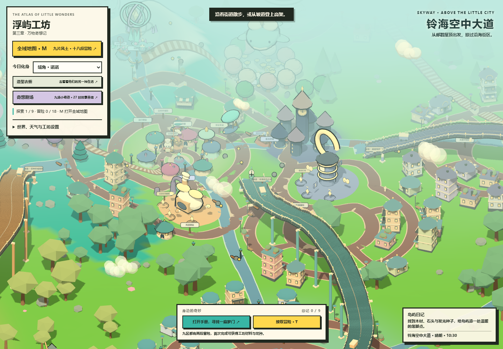
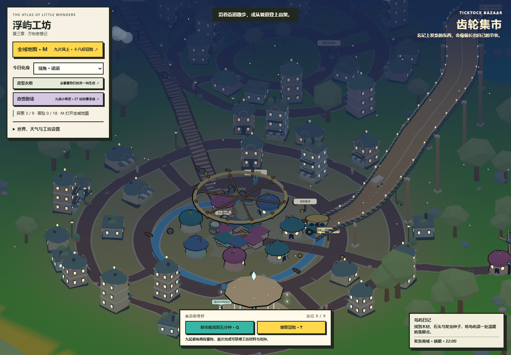

# 街巷与高架：让奇想群岛住满生活

本轮扩展已经接入游戏。保留九片风土、九处剧场与十八段冒险，在聚落外围和旅行途中增加完整街区，把地面街道与可实际通行的高架连接起来。

## 城市密度与风格

默认种子 `LUMEN-07` 下新增 144 幢建筑，分布在 10 片街区。地面道路从 27 段增加到 105 段，其中新增 78 段环街、支路和接驳路。其他种子或地形编辑可能改变个别建筑的布置；手册显示当前实际数量。

| 街区 | 默认新增建筑 | 生活与建筑 |
| --- | ---: | --- |
| 云铃环城街 | 7 | 原有小镇外围的邮戳屋顶、花店与露台 |
| 铃东叠屋街 | 9 | 两三层小店、条纹雨棚、屋顶花园 |
| 梦孢灯巷 | 15 | 紫色伞屋、薄荷窗框与林间灯饰 |
| 鲸眠花坊 | 10 | 珊瑚色屋顶、花箱和北方中转街 |
| 海风阶街 | 19 | 蓝色圆顶、层叠阳台与港口商铺 |
| 发条南城 | 21 | 铜色钟饰、修钟店与高架下的市场 |
| 薄荷驿城 | 20 | 奶油色圆顶、糖沙商路与歇脚长椅 |
| 星邮坡城 | 11 | 接住落雪的尖顶、山坡街道与星灯 |
| 雨歇花园坊 | 15 | 花商小店、沿街绿植与穿过花园的路 |
| 风筝中转街 | 17 | 通向雪境的中转小城与钟饰屋顶 |

每片街区有内外环街、四条支路和对外连接。房屋有一至三层的变化；高层阳台、花园平顶、圆顶、尖顶、店铺雨棚和灯窗组合出不同街景。放置建筑时检查道路、已有建筑、居民、生活角、原有任务点与剧场的留白，保留可步行的空间。

## 四条立体路线

| 高架 | 两端 | 特点 |
| --- | --- | --- |
| 铃海空中大道 | 云铃环城街 ↔ 泡泡海港 | 从小镇东侧缓缓升起，穿过新街区并落在海港外环 |
| 花钟环城高架 | 梦孢林南侧 ↔ 发条南城 | 跨过花园与南行小路，接入集市外街 |
| 星邮观景长桥 | 暮光钟城 ↔ 星邮坡城 | 沿山势上行，夜间由桥灯标出通往雪境的方向 |
| 薄荷回风栈道 | 梦孢林南侧 ↔ 薄荷驿城 | 将森林、花园与糖沙商路连成一段观景旅程 |

高架有桥面、桥柱、横梁、双侧护栏、桥灯和地面坡道。桥面与地面是不同的通行表面：从坡道可以走上桥，从桥下经过不会被吸到桥上。地面车辆也使用这一高度判断；在桥上召回车辆、乘车、下车和保存后读回都保留所在层。

护栏限制桥面上的横向移动。这里仍是轻量沙盒运动系统，不是完整物理引擎；飞行载具没有新增桥面碰撞模拟，行驶中的景观班车不处理交通事故或排队。

## 街上的日常

- 40 位街头小居民分布在十片街区，沿固定街道散步。它们是独立的环境角色，不替代十位可交谈的故事伙伴。
- 8 辆观光班车沿四条高架往返，用来呈现城市交通。它们是景观车辆，不能登乘；原有邮车、小巴、浮舟与星帆艇仍可召回和驾驶。
- 窗灯、路灯与桥灯随夜色亮起。阳台、花箱、街边长椅与店铺雨棚形成近景细节。
- 原有九处剧场、27 张明信片与十八段冒险保留；本轮增加的是空间与环境生活，没有增加新任务数量。

## 地图、存档与地形

按 **M** 打开全域地图。细线显示真实地面道路，棕金色双线显示高架，浅棕小方块显示新增建筑。地图下方提供四条高架的坡道入口，以及十片街区的快捷目的地。

存档格式继续兼容 v6 及旧版 v2–v5。角色已有的 `player.y` 和新增的车辆 `y` 用于恢复桥上／桥下的位置，只有靠近有效桥面的高度才会被接受；旧档缺少车辆高度时回到地面。仍需手动保存，没有云端同步。

地形编辑会重建城市的贴地几何、桥柱和桥面，让坡道继续贴合编辑后的地形。世界重建会释放本轮创建的网格、实例缓冲与材质，移除旧道路和碰撞记录，再生成新的街区。新增房屋使用按街区分批的实例网格，窗户、屋顶与灯饰不逐件创建独立渲染对象。

## 文件与验证

- `world-city.js`：街区与路线定义、建筑实例、环境行人、观光班车、桥面查询、护栏约束、地图图层与导览。
- `world-city.css`：地图内导览卡片及手机布局。
- `index.html`：步行／驾驶／上下车／读档接入分层高度，城市生成、地形编辑与昼夜循环接入模块。
- `scripts/verify-city.cjs`：通过测试专用接口驱动实际游戏；接口不进入发行页面。

专项覆盖四条路线完整步行、整段小巴驾驶、桥下穿行、护栏、桥上步行与驾驶存档、桥上下车、旧档、地形编辑、重复生成、目的地保护和手机布局，并生成日景、夜景与地图实机截图。测试结果保存在本地忽略目录 `.local/`；这不等同于不同硬件上的性能保证。

本轮验证通过：城市与高架专项 24 项、剧场 47 项、衣橱与存档回归 131 项、实际部署 12 项，共 214 项。实际部署检查没有外部网络请求或浏览器报错。

